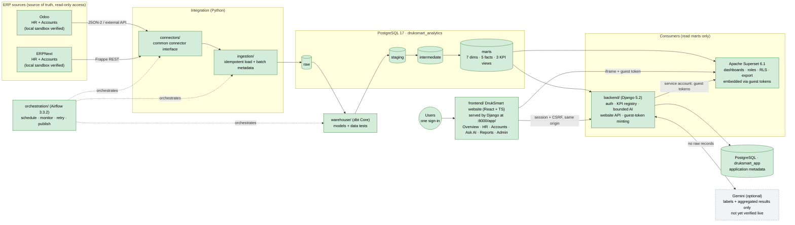
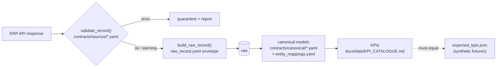

# Architecture

This document describes the **planned** end-to-end architecture and marks what is **actually
implemented**. Keep it in sync with the code at the end of every milestone.

Legend: ✅ implemented and tested · 🟡 partially implemented · ⬜ planned

## 1. End-to-end architecture

Green = exists now (Milestones 1–10). Since Milestone 10 users work in **one website** ([web/WEB_APP_ARCHITECTURE.md](web/WEB_APP_ARCHITECTURE.md)): Django serves it and its API on one origin; Superset dashboards are embedded with per-user, per-dashboard guest tokens whose RLS rules Django decides ([web/EMBEDDING.md](web/EMBEDDING.md)). The Django KPI service reads only its 4 approved datasets as
`druksmart_kpi_reader` ([backend/BACKEND.md](backend/BACKEND.md)). Gemini is implemented but unverified
(no API key), so it is shown grey. Superset reads only the 4 approved KPI/freshness datasets, as
`druksmart_superset_reader` ([bi/SUPERSET.md](bi/SUPERSET.md)). Grey dashed = planned. ERP connectivity is verified against local
sandboxes with synthetic data, not yet against DrukSmart's instances. Connector details:
[connectors/CONNECTORS.md](connectors/CONNECTORS.md).

## 2. Component status

| Component | Status | Notes |
|-----------|--------|-------|
| PostgreSQL 17.11 (Docker Compose) | ✅ | `compose.yaml`; named volume `druksmart_pgdata`; health check; 127.0.0.1:5433 |
| `druksmart_analytics` + `raw/staging/intermediate/marts` schemas | ✅ | Created by idempotent init script; owned by `pipeline` role |
| `druksmart_app` database | ✅ | Empty; for Django in later milestones |
| Least-privilege roles (`pipeline`, `bi_reader`, `app`) | ✅ | Verified by smoke tests and manual negative tests |
| Settings validation, DB helper, health checks (`druksmart_common`) | ✅ | Unit- and smoke-tested |
| Source data contracts (`contracts/sources/`), raw envelope, canonical models, verified identity mappings | ✅ | Milestone 2; from documentation/source code, **not yet verified against live ERPs** |
| Contract validator + raw-record builder (`druksmart_common.contracts`) | ✅ | Unit-tested; used by future connectors |
| Synthetic Odoo/ERPNext fixtures + hand-calculated expected KPIs | ✅ | `tests/fixtures/synthetic/`; cross-checked by `tests/support/kpi_reference.py` (test-only) |
| Connector interface + Odoo 19 (JSON-2) and ERPNext 16 (REST) adapters | ✅ | Milestone 3; read-only; retries/backoff; keyset paging; **live-verified against local sandboxes only** |
| Raw ingestion: `raw.extraction_run`, `raw.source_record` (versioned), quarantine, checkpoints, `raw.current_source_record` | ✅ | Idempotent, incremental, recoverable; `python -m ingestion …` CLI |
| Local ERP sandboxes (Odoo 19, ERPNext 16 + HRMS) | ✅ | Development only, synthetic data; `infrastructure/sandboxes/` |
| Extraction against DrukSmart's real ERPs | ⬜ | Needs DrukSmart credentials and versions |
| dbt project: staging (18), intermediate (8), marts (7 dims, 5 facts), KPI views (3), 143 data tests | ✅ | Milestone 4; reproduces the hand-calculated KPIs end to end ([warehouse/WAREHOUSE.md](warehouse/WAREHOUSE.md)) |
| Isolated `druksmart_analytics_test` database for warehouse tests | ✅ | Created by the init script |
| Airflow orchestration (DAG `druksmart_elt`, LocalExecutor, own metadata DB, build-test-swap publication, synthetic mode) | ✅ | Milestone 5 ([orchestration/ORCHESTRATION.md](orchestration/ORCHESTRATION.md)) |
| Superset 6.1.0: approved datasets, certified metrics, HR + Accounts dashboards, 5 roles + RLS, asset export/restore | ✅ | Milestone 6 ([bi/SUPERSET.md](bi/SUPERSET.md)); own metadata DB `superset-db`; verified per role via API and headless browser |
| Django 5.2 backend: auth, roles/branch scope, KPI function registry (8 functions), NL assistant (rules interpreter), UI, health checks, question log | ✅ | Milestone 7 ([backend/BACKEND.md](backend/BACKEND.md)); values equal Superset (tested) |
| Django backend container (`druksmart/backend:5.2.18`, gunicorn, Compose profile `backend`) and operations script `deploy/druksmart.py` | ✅ | Milestone 9 ([DEPLOYMENT.md](DEPLOYMENT.md)); clean-start deployment tested |
| Platform evaluation tools (`evaluation/`): end-to-end, reconciliation, reliability, access matrix, performance, regression runner | ✅ | Milestone 8 ([evaluation/EVALUATION_REPORT.md](evaluation/EVALUATION_REPORT.md)) |
| DrukSmart website (`frontend/`, React 19 + TypeScript): overview, embedded HR/Accounts dashboards, Ask AI, reports, administration; session sign-in with throttling; guest-token embedding with Django-decided branch RLS | ✅ | Milestone 10 ([web/FRONTEND.md](web/FRONTEND.md)); verified in Edge (161 checks incl. a 12-step journey per role and a WCAG 2.1 AA audit) |
| Gemini function-calling provider | 🟡 | Implemented and tested with a mocked API; not verified against the real service (no key) |

## 3. Data layers and contracts

| Layer | Written by | Read by | Contract |
|-------|-----------|---------|----------|
| `raw` | ingestion (pipeline role) | dbt | Source-shaped records + `source_erp`, `source_instance`, `source_id`, `extraction_batch_id`, `extracted_at`. Loads are idempotent |
| `staging` | dbt | dbt | One model per source entity per ERP; renamed, typed, cleaned; still source-specific |
| `intermediate` | dbt | dbt | Cross-ERP standardised entities; status/code mappings; entities merged across ERPs **only** via verified mappings |
| `marts` | dbt | Superset, Django KPI functions (bi_reader) | Kimball facts with documented grain, conformed dimensions (Date, Organisation, Branch, …), validated KPI datasets |

### Contract-driven data flow (Milestone 2)

Detailed analysis and rules: [ERP_SOURCE_ANALYSIS.md](data/ERP_SOURCE_ANALYSIS.md),
[SOURCE_TO_TARGET_MAPPING.md](data/SOURCE_TO_TARGET_MAPPING.md), [KPI_CATALOGUE.md](data/KPI_CATALOGUE.md).

## 4. Security boundaries (database level)

| Role | Can | Cannot |
|------|-----|--------|
| `POSTGRES_USER` (bootstrap superuser) | Initialise the server | Is never used by application code |
| `pipeline` | Connect to analytics DB; own and write all four schemas | Connect to `druksmart_app` |
| `bi_reader` | Connect to analytics DB; `SELECT` on `marts` (including future tables via default privileges) | See `raw`/`staging`/`intermediate`; write anywhere |
| `app` | Own `druksmart_app` | Connect to `druksmart_analytics` |
| `kpi_reader` | Connect to analytics DB; `SELECT` on `backend/approved_datasets.yml` only (incl. the request-grain leave view, aggregated in the backend); read-only sessions | See dimensions, facts, `raw`/`staging`/`intermediate`; write anywhere |
| `superset_reader` | Connect to analytics DB; `SELECT` on the approved datasets only (granted by `publish.py`); read-only sessions | See dimensions with names, facts, `raw`/`staging`/`intermediate`; write anywhere |

Dashboard-level permissions (roles, dataset permissions, row-level security per branch) are enforced in
Superset (Milestone 6), for dashboards, Explore and CSV export alike.
AI and KPI-API permissions are enforced in Django (Milestone 7) before any warehouse query. Neither may bypass the other (see `CLAUDE.md` §2).

## 5. Runtime environment

| Piece | Runs where | Why |
|-------|-----------|-----|
| PostgreSQL | Docker container | Identical version for every team member; isolated from the native PostgreSQL 18 service on 5432 |
| Python code (connectors, ingestion, dbt, tests) | Host `.venv` | Fast edit-run loop for students |
| Source versions targeted | Odoo 19.0 (JSON-2 API), ERPNext/HRMS 16 (Frappe REST) | See ADR-008 |
| Airflow, Superset, ERP sandboxes | Docker | Airflow does not support native Windows; images are the supported distribution |
