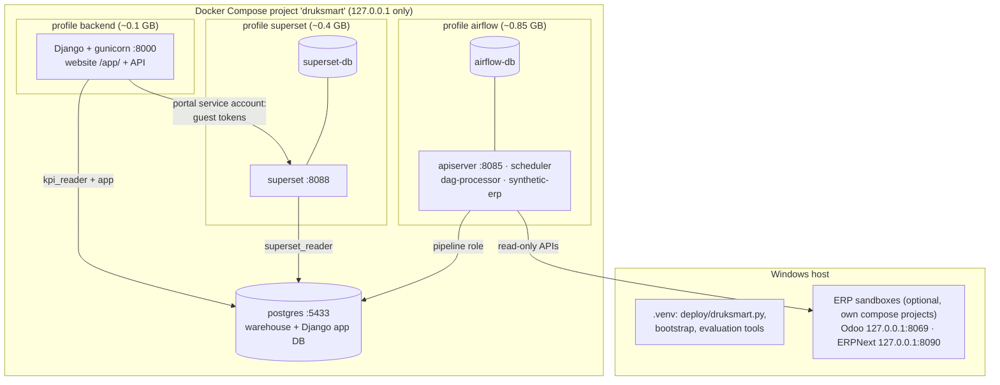

# Deployment, operations, backup and troubleshooting (Milestone 9)

Target: **local demonstration / prototype deployment on one Windows machine** with Docker Desktop.
This is not a production topology. It has no HTTPS, no high availability and development-grade
servers, so read §9 before any wider use.

## 1. What runs where



**Start-up order** (enforced by `deploy/druksmart.py up` and the Compose health checks):
PostgreSQL → Airflow (metadata DB → init → services) → Superset (metadata DB → init → web) → backend.

**Resource requirements.** Measured idle memory on the reference machine (Docker VM limit 7.4 GiB):

| Component | Memory (idle) | Needed for |
|---|---|---|
| postgres | ~70 MiB | everything |
| Airflow (5 containers) | ~850 MiB (more during dbt runs) | scheduled refresh, pipeline demo |
| Superset + metadata DB | ~380 MiB | dashboards |
| backend | ~110 MiB | the website, assistant, KPI API |
| ERP sandboxes (Odoo + ERPNext) | ~650 MiB | live extraction (development only) |

Recommendations:
- **Machine:** 16 GB RAM and 25 GB free disk. Give Docker Desktop at least 6 GB.
- **Low memory:** on smaller machines, use `up --minimal` (no Airflow; the data stays as last published) and start the ERP sandboxes only when extracting.
- **Disk:** the platform images take about 6.2 GB (Airflow 3.84 GB, Superset 1.28 GB, backend 0.48 GB, postgres 0.63 GB). The optional ERP sandbox images add about 8.3 GB (ERPNext 4.47 GB, Odoo 3.29 GB, MariaDB and Redis about 0.5 GB). Measured with `docker image ls`.

## 2. First-time setup (Windows, PowerShell)

Prerequisites:
- Docker Desktop (WSL2), Python 3.12+ and Git ([DEVELOPMENT_SETUP.md](DEVELOPMENT_SETUP.md) §1);
- for a fresh machine without network access to PyPI during image builds, see §3 first.

```powershell
git clone <repository-url> FYP; cd FYP
python -m venv .venv; .\.venv\Scripts\Activate.ps1
python -m pip install -e ".[dev,warehouse,backend,bi-test]"
python deploy\druksmart.py check          # tools, RAM, disk, free ports
python deploy\druksmart.py setup --build  # .env with random passwords, images, databases,
                                          # services, first pipeline run, Superset, demo users
```

**What `setup` does.** Every step is idempotent and safe to repeat.
1. **Settings:** creates `.env` from `.env.example` with random passwords, or adds missing keys (values are never printed).
2. **Prerequisite check:** fails early with a clear message.
3. **Images:** `--build` builds `druksmart/airflow`, `druksmart/superset` and `druksmart/backend` offline from wheels.
4. **PostgreSQL:** starts it and runs the init script (roles, databases, schemas, grants).
5. **Services:** starts Airflow, Superset and the backend in order and waits for health. The backend runs Django `migrate` and `seed_roles` itself.
6. **Raw tables:** applies the raw-table migrations through the pipeline container.
7. **Data:** if nothing is published yet, runs the pipeline once:
   - **configured** when the ERP sandboxes (or real ERPs in `.env`) are reachable;
   - **synthetic** otherwise.
8. **Superset bootstrap:** database connection, governed datasets, roles, RLS and dashboards.
9. **Demo users:** creates local demo users for Superset and Django when the demo passwords are set.
10. **Schedule:** unpauses the daily schedule if the ERP sources are reachable.

**ERP sources.**
- **Local sandboxes:** `python infrastructure\sandboxes\sandbox.py up odoo|erpnext`, then `seed` ([connectors/SANDBOXES.md](connectors/SANDBOXES.md)).
- **Real ERPs:** set `ODOO_*` / `ERPNEXT_*` in `.env`, using **read-only** API users ([connectors/CONNECTORS.md](connectors/CONNECTORS.md)).

## 3. Offline image builds (wheels)

Images install Python packages **offline**, which keeps builds reproducible on slow networks:

| Folder (git-ignored) | Contents | Used by |
|---|---|---|
| `orchestration/docker/wheels/` | Linux cp312 wheels of the pipeline + dbt (66 files) | Airflow and backend images |
| `backend/docker/wheels/` | `django-5.2.18`, `asgiref-3.13.0`, `gunicorn-26.2.0` (pure Python) | backend image |

**The website** (Milestone 10) is built inside the backend image by a first stage on
`node:24.14.0-bookworm-slim` (`npm ci` from `frontend/package-lock.json`, then `npm run build`). That
stage needs the npm registry once; later builds use Docker's layer cache. The running container
has no Node.

To fill them on a new machine, see [orchestration/ORCHESTRATION.md](orchestration/ORCHESTRATION.md) §9:
`pip download --only-binary=:all: --platform manylinux2014_x86_64 --python-version 3.12 -r … -d …`,
or `pip install --dry-run --report` plus `curl -C -` on slow networks. The pins are in
`orchestration/docker/requirements-pipeline.txt` and `backend/docker/requirements-backend.txt`.

## 4. Daily operations

| Task | Command |
|---|---|
| Start everything (ordered, waits for health) | `python deploy\druksmart.py up` |
| Start without Airflow (low RAM) | `python deploy\druksmart.py up --minimal` |
| What is running and how fresh is the data | `python deploy\druksmart.py status` |
| Refresh the data now | `python deploy\druksmart.py run-pipeline` (configured) or `--synthetic` |
| Demonstration fallback data | `python deploy\druksmart.py demo-data synthetic`; back with `demo-data live` |
| Stop (keeps **all** data) | `python deploy\druksmart.py stop` |
| The website | `http://127.0.0.1:8000/app/` (status shows `Website /app/ OK`) |
| Health endpoints | `http://127.0.0.1:8000/health/ready/`, `http://127.0.0.1:8088/health`, `http://127.0.0.1:8085/api/v2/monitor/health` |
| After changing the website (`frontend/`) | `docker compose --profile backend build backend`, then `python deploy\druksmart.py up` |
| Full website check (Edge) | `python frontend\scripts\browser_check.py` |
| Full regression | `python evaluation\run_regression.py` |

Nothing in `deploy/druksmart.py` removes Docker volumes. `docker compose down -v` deletes **all**
platform data and is never needed for normal operation.

## 5. Configuration (`.env`)

`.env` is git-ignored and created by `infrastructure/scripts/create_local_env.py`. `.env.example`
documents every key. The main groups:

| Group | Keys | Notes |
|---|---|---|
| PostgreSQL / roles | `POSTGRES_*`, `DRUKSMART_PG_PORT`, `DRUKSMART_*_USER/PASSWORD` (pipeline, bi_reader, app, superset_reader, kpi_reader) | passwords re-applied by the init script |
| ERP sources | `ODOO_*`, `ERPNEXT_*`, `DRUKSMART_HTTP_TIMEOUT_SECONDS`, `DRUKSMART_PAGE_SIZE` | read-only API users only |
| Airflow | `AIRFLOW_*`, `DRUKSMART_SOURCE_MODE`, `DRUKSMART_ELT_SCHEDULE` | schedule `none` = manual only |
| Superset | `SUPERSET_*` | `SUPERSET_SECRET_KEY` encrypts stored DB passwords: keep it with backups |
| Website embedding (M10) | `SUPERSET_GUEST_TOKEN_SECRET`, `SUPERSET_PORTAL_SERVICE_USER/_PASSWORD`, `DRUKSMART_WEB_ORIGIN` | the secret signs guest tokens (Superset refuses to start without it); the service account only issues tokens; the origin is the only site allowed to frame Superset. A stack on another `BACKEND_PORT` must set `DRUKSMART_WEB_ORIGIN` to match |
| Django / AI | `DJANGO_*`, `BACKEND_*`, `DRUKSMART_AI_PROVIDER`, `GEMINI_*`, `DRUKSMART_STALE_AFTER_HOURS`, `DRUKSMART_CONSUMER_DATA` | `GEMINI_API_KEY` empty = rules interpreter |

Each container receives **only** the keys listed for it in `compose.yaml`, and the repository `.env`
is masked inside the Airflow and backend containers.

### Upgrading an existing installation to the website (Milestone 10)

```powershell
python infrastructure\scripts\create_local_env.py --add-missing   # adds the 4 embedding keys (values never printed)
docker compose --profile backend build backend                     # builds the website into the image
python deploy\druksmart.py up                                      # Superset restarts with embedding enabled
python superset\scripts\bootstrap.py                               # guest role, service account, embedded dashboards
python frontend\scripts\browser_check.py                           # optional: 161 checks in Edge
```

`setup` does all of this on a new machine.

## 6. Backup and recovery

```powershell
python deploy\druksmart.py backup [--include-env]      # -> backups\<timestamp>\ (git-ignored)
python deploy\druksmart.py restore-check backups\<ts>   # restore into TEMPORARY databases + compare
python deploy\druksmart.py restore backups\<ts> --yes   # REPLACE the databases (destructive)
```

| Backed up | How | Not backed up (and why) |
|---|---|---|
| Warehouse `druksmart_analytics` (raw history, marts, publication log) | `pg_dump` custom format, SHA-256 in `manifest.json` | the `_test` database (rebuilt by the tests and synthetic replays) |
| Django `druksmart_app` (users, role groups, branch scopes, question log) | `pg_dump` | Django sessions (users log in again) |
| Superset metadata (users, roles, RLS, datasets, charts, dashboards, saved queries) | `pg_dump` of `superset-db`, plus a native YAML asset export (`superset_assets/`) | the encrypted warehouse password inside it needs the **same `SUPERSET_SECRET_KEY`** |
| Airflow metadata (run history, pools, users) | `pg_dump` of `airflow-db` | task log files (volume `airflow_logs`; diagnostic only) |
| Configuration | everything except secrets is in Git (`superset/definitions`, `contracts`, `warehouse`, `backend`, compose); `--include-env` copies `.env` as `env.SECRET` | ERP sandbox data (development fixtures; re-seed with `sandbox.py seed`) |

**Restore notes.**
- **What it does:** `restore` replaces the warehouse, app and Superset databases, keeps object ownership and grants from the dump, re-applies roles and passwords from the **current** `.env`, re-grants the consumers, restarts Superset and the backend, and re-runs the Superset bootstrap.
- **Safest order:** stop Airflow first (`docker compose stop airflow-scheduler`) so that no run publishes during the restore.

**Tested (2026-10-25):**
- **Backup:** dumped 196 KB (warehouse), 50 KB (app), 586 KB (Superset) and 244 KB (Airflow).
- **`restore-check`:** reproduced all row counts in temporary databases.
- **Full restore into a separately deployed stack:** reproduced the row counts, publication 19 and the 5 users. Reconciliation then passed 30/30 and the dashboards loaded per role (§8).

**Defect found while testing:** restoring with `--no-owner` made the superuser own everything and locked out the pipeline. Fixed: ownership now comes from the dump.

## 7. Recovering from a failed start or run

| Symptom | Cause | Fix |
|---|---|---|
| `docker info` fails / "Docker Desktop is unable to start" | Docker backend stuck | Quit Docker Desktop, `wsl --shutdown`, start Docker, then `python deploy\druksmart.py up` |
| `check` reports a port in use | another program on 5433/8085/8088/8000 | stop it, or change `DRUKSMART_PG_PORT` / `AIRFLOW_PORT` / `SUPERSET_PORT` / `BACKEND_PORT` in `.env` |
| A service stays `starting` or `unhealthy` | first start (migrations) or not enough memory | `docker compose logs --tail 50 <service>`; give Docker more RAM; re-run `up` (idempotent) |
| `superset-init` or `airflow-init` exited with an error | metadata DB not ready or a bad setting | fix the setting, then `python deploy\druksmart.py up` |
| `/health/ready/` 503 `stale` | no successful publication for more than 30 h | check the last DAG run in Airflow; `run-pipeline` |
| `/health/ready/` 503 warehouse `InsufficientPrivilege` | marts never published, or grants missing | `run-pipeline`; or `docker compose exec airflow-scheduler /opt/druksmart-venv/bin/python /opt/druksmart/warehouse/publish.py grant-consumers` |
| DAG run failed at `validate_*` | ERP down or credentials wrong | the previous data stays published; start the sandboxes (`sandbox.py up …`), then clear the run in Airflow or `run-pipeline` |
| DAG run failed at `dbt_*` | a data-quality test failed | nothing was published; open the task log, fix the source data or the model, re-run |
| A manually triggered run stays `queued` | DAG paused | `docker compose exec airflow-scheduler airflow dags unpause druksmart_elt` (`run-pipeline` does this automatically) |
| Superset login fails after changing `.env` | the admin is only created on first start | `docker compose exec superset superset fab reset-password --username admin --password <new>` (typed yourself) |
| Everything is broken | — | `python deploy\druksmart.py backup` (if possible), then restore the last good backup (§6) |

## 8. Clean-start deployment test (Milestone 9)

A **second, isolated** stack was deployed from scratch:
- **Isolation:** the project `druksmartclean`, ports 5434/8086/8089/8001 and empty volumes, from a copy of `.env`.
- **Command:** `python deploy\druksmart.py --env-file <file> setup`.
- **Main stack:** kept running and untouched.

Results are recorded in `docs/evaluation/results/clean_start_*.json` and §9 of the handover report.
| Test (2026-10-25) | Result |
|---|---|
| 1st clean `setup` (ERP sandboxes reachable) | All services healthy; configured extraction published. The first run stayed **queued** because a new DAG is paused: defect found and fixed (`run-pipeline` now unpauses). Full regression against this stack: **12/12 stages** (495 pytest tests, browser dashboards, reconciliation 30/30, access matrix 115/115) |
| Full restore of the main stack's backup into this stack (`restore --yes`) | Row counts, publication 19 and 5 users reproduced. With `--no-owner` the pipeline lost ownership: defect found and fixed. After the fix, reconciliation 30/30 and dashboards per role all PASS |
| Synthetic fallback (`demo-data synthetic`, then `live`) | 16 employees, AR 221,200.00, 13.5 leave days (= hand-calculated); labelled in Superset and in every answer; switched back to live correctly |
| 2nd clean `setup`, **unattended** with the fixed script | **515 s** from empty volumes to working (services, configured run, Superset, demo users, schedule); reconciliation 30/30; dashboards per role PASS |
| 3rd clean `setup` with **no reachable ERP** | **656 s**; comes up with the labelled synthetic dataset (DAG left paused); answers equal the hand-calculated values |
| Main stack: `stop` then `up` | All services healthy after 215 s; data unchanged (publication 19, 138 raw versions, 82 headcount rows) |
| **Milestone 10:** clean `setup --build` with the website, **unattended** | **595 s** to working, with the embedding bootstrap (guest role, service account, embedded dashboards) and the website on :8001. `browser_check.py --env-file … --base http://127.0.0.1:8001`: **161/161** (after making the check's Superset-console filter port-independent; the first run's 6 failures were that filter, every functional check passed) |

The throwaway project `druksmartclean` was removed after the tests (only its own containers and
volumes). The main `druksmart_*` and sandbox volumes were never touched.

## 9. Before any wider deployment (not done in this prototype)

- **Network and TLS:** HTTPS reverse proxy; no services on public interfaces; secure cookies (`DJANGO_SECURE_COOKIES=true`).
- **Infrastructure:** separate or managed PostgreSQL with HA for the warehouse vs application data (D11); scheduled and off-site backups.
- **Identity:** SSO for Superset and Django; remove or restrict `bi_reader` (D7). Django sign-in throttling (D6) exists since M10 Task 10.3.
- **Operations:** monitoring and alerting (failed DAG runs, stale data); load tests.
- **Data sources:** DrukSmart's real ERPs, with read-only API users created by their administrators.
