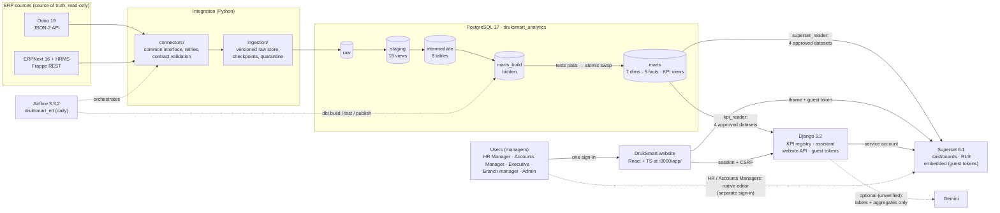
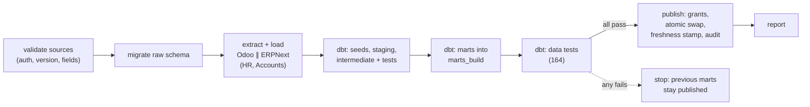
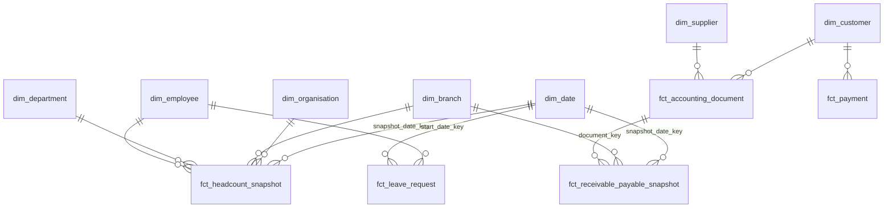
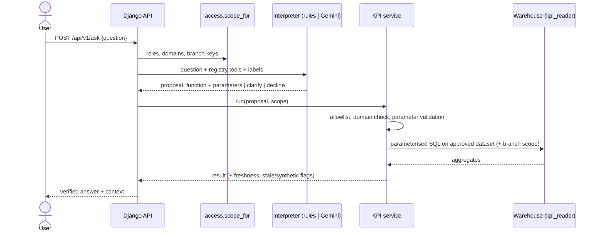

# DrukSmart Analytics & AI Dashboard Platform: technical documentation

Version 1.0 (Milestone 9, 2026-10-25). Group 8, College of Science and Technology, Royal University of
Bhutan. Industry partner: DrukSmart.

This document summarises the **implemented** system and links to the detailed documents for each
component. Status labels:
- **verified** = implemented and tested;
- **unverified** = implemented, not tested against the real service;
- **not implemented**.

## 1. Project overview

The platform integrates **HR** and **Accounts** data from **Odoo** and **ERPNext** into a validated
analytical warehouse. It gives role-based **dashboards** (Apache Superset) and a **bounded natural-language
assistant** (Django) that answers only through approved KPI functions. **Apache Airflow** refreshes and
publishes the data on a schedule.

| Fact | Value |
|---|---|
| ERP sources | Odoo 19 (JSON-2 API), ERPNext/HRMS 16 (Frappe REST): read-only |
| Modules | Human Resources, Accounts (receivables/payables) |
| KPIs | HR-01 headcount, HR-02 by department, HR-03 approved leave, AC-01 receivables, AC-02 payables, AC-03 overdue, AC-04 ageing |
| Deployment | One client organisation per deployment; Docker Compose on one machine (demonstration/prototype) |
| Verified against | Local ERP **sandboxes with synthetic data**, and hand-calculated synthetic fixtures. **Not** DrukSmart's ERPs |

## 2. Problem statement and implementation scope

DrukSmart's client organisations run more than one ERP. HR and finance figures must be combined
manually from separate systems, with different data models, status codes and accounting conventions,
so they are slow to obtain, hard to reconcile and not consistently defined. The project builds a
prototype that:

- extracts HR and Accounts records **without modifying** the ERPs;
- integrates both ERPs into one consistently defined, tested data model;
- publishes only validated KPIs, to dashboards and to a controlled AI assistant;
- enforces role- and branch-level access in every system that queries data.

**In scope:**
- Odoo and ERPNext; HR and Accounts;
- PostgreSQL, dbt, Airflow, Superset and Django;
- bounded AI over approved KPI functions;
- one organisation per deployment.

**Out of scope (future work):**
- multi-tenant SaaS;
- other ERPs (SAP, Oracle, Dynamics);
- Sales, Finance and Inventory modules;
- real-time streaming;
- forecasting (optional, not started).

## 3. System architecture

**Deployment topology.** Docker Compose project `druksmart`; every port is bound to 127.0.0.1.

| Service | Image | Port | Data volume | Profile |
|---|---|---|---|---|
| postgres (warehouse + Django app DB) | postgres:17.11-bookworm | 5433 | `druksmart_pgdata` | always |
| airflow-db, airflow-init, airflow-apiserver, airflow-scheduler, airflow-dag-processor, synthetic-erp | druksmart/airflow:3.3.2 | 8085 | `druksmart_airflow_db`, `druksmart_airflow_logs` | airflow |
| superset-db, superset-init, superset | druksmart/superset:6.1.0 | 8088 | `druksmart_superset_db` | superset |
| backend (Django + gunicorn; serves the website built into the image) | druksmart/backend:5.2.18 | 8000 | (uses `druksmart_app` in postgres) | backend |
| ERP sandboxes (development only) | odoo:19.0, frappe/erpnext:v16.52.0 | 8069, 8090 | own projects | separate compose files |

## 4. Technology stack and justification

| Layer | Technology (version) | Why this choice |
|---|---|---|
| Integration | Python 3.12/3.14, httpx 0.28 | API-driven read-only access; one connector interface for both ERPs; testable with fake transports |
| Storage | PostgreSQL 17.11 | Mature, free, strong SQL; one server for raw, warehouse and app metadata (prototype) |
| Transformation | dbt Core 1.12.0 + dbt-postgres 1.11.0 | SQL models with lineage, tests and documentation; the industry standard for ELT |
| Modelling | Kimball star schemas | Explicit grains and conformed dimensions; easy for BI tools and for verification |
| Orchestration | Apache Airflow 3.3.2 (LocalExecutor) | Scheduling, retries, monitoring, history; LocalExecutor avoids Redis/Celery on a laptop |
| BI | Apache Superset 6.1.0 | Native dashboard authoring, roles, row-level security, export; no custom designer needed |
| Backend / AI | Django 5.2 LTS, gunicorn 26 | Auth, admin and ORM out of the box; LTS support to 2028; the AI is a constrained layer over a KPI registry |
| Website | React 19 + TypeScript 6.0, Vite 8, React Router 8, Superset Embedded SDK 0.4.0 | One product for all users; same origin as the Django API (session + CSRF); official SDK for embedding instead of a custom dashboard designer |
| AI provider | Gemini (REST function calling), optional | Structured tool calls instead of SQL generation; replaceable; deterministic rules as a labelled fallback |
| Deployment | Docker Compose (profiles) | Reproducible on Windows (WSL2); Airflow and Superset ship as images |
| Testing | pytest 9, pytest-django, Playwright (Edge) | Unit to end-to-end, including real-browser checks |

Decision records: [DECISIONS.md](DECISIONS.md) (ADR-001 … ADR-043).

## 5. ERP API integration

Details: [connectors/CONNECTORS.md](connectors/CONNECTORS.md), [connectors/SANDBOXES.md](connectors/SANDBOXES.md),
[data/ERP_SOURCE_ANALYSIS.md](data/ERP_SOURCE_ANALYSIS.md).

- **Odoo 19.** `POST /json/2/<model>/search_read` with a bearer **API key of a read-only bot user**.
  - Entities: `res.company`, `hr.department`, `hr.employee`, `hr.leave`, `res.partner`, `account.move`, `account.payment`.
  - The connector allows only read methods (`search_read`, `search_count`, `fields_get`, `context_get`).
- **ERPNext 16.** `GET /api/resource/<doctype>` with `token key:secret` of a **read-only role**.
  - Doctypes: Company, Branch, Department, Employee, Leave Application, Customer, Supplier, Sales Invoice, Purchase Invoice, Payment Entry.
- **Contracts.** `contracts/sources/*.yaml` declare fields, types, required values and paging. Every record is validated: invalid records are **quarantined** with the reason, never loaded.
- **Incremental and idempotent.**
  - **Windows:** each extraction uses a modified-since window and a keyset cursor, with a checkpoint saved only on success.
  - **Versioning:** raw keeps one row per distinct payload (SHA-256), so re-extracting adds nothing (verified: a repeat run added 0 versions).
  - **Metadata:** every row carries the source system, instance, entity and id, the run id and timestamps.
- **Resilience.** Retries with exponential backoff on 429/5xx/timeouts, plus Airflow task retries (verified in the reliability tests).

## 6. Source-to-target mappings

Details: [data/SOURCE_TO_TARGET_MAPPING.md](data/SOURCE_TO_TARGET_MAPPING.md), `contracts/canonical/*.yaml`,
`contracts/mappings/entity_mappings.yaml`.

| Target (canonical) | Odoo 19 | ERPNext 16 | Rule |
|---|---|---|---|
| employment_status = active | `active` and (no `departure_date` or after D) | `status = Active`, joined on/before D, not relieved by D (seeded status map) | Statuses mapped explicitly; unknown values are flagged |
| department | `department_id` (per company; same names kept apart) | `department` (name with company suffix) | Keys `system:instance:id`; never merged by name |
| approved leave | `state = validate` | `docstatus = 1` and `status = Approved` | Counted in the month the leave **starts** (DS-HR-03) |
| document ledger / kind | `move_type` out_/in_ invoice/refund | Sales/Purchase Invoice, `is_return` | Seeded map; sign +1 invoice, −1 credit note |
| outstanding (company currency) | `amount_residual_signed` | `outstanding_amount` × `conversion_rate` when in document currency | Drafts, cancelled and Odoo `invoicing_legacy` excluded |
| organisation / branch | root company / company | `company` / Branch (none on invoices: DS-AC-05 → "Unassigned") | Organisation from the invoice's own company (M7 fix) |
| cross-ERP customer | `res.partner` (+ VAT) | Customer (+ tax id) | Unified **only** through verified mappings in `entity_mappings.yaml` |

## 7. ELT pipeline

- **Extract–Load.** The pipeline runs `python -m ingestion extract`.
- **Transform.** dbt runs in three steps, so a failure says which layer broke.
- **Publish.** `warehouse/publish.py` works in one transaction:
  - it grants each consumer **only** its approved relations;
  - it swaps `marts_build` into `marts`;
  - it stamps `marts.data_freshness`;
  - it logs to `raw.publication`.

  If any step fails, the transaction rolls back.
- **Source modes.** `configured` is the ERPs from `.env`. `synthetic` is the fictional fixtures through the same code path, written to `druksmart_analytics_test`.

## 8. Analytical warehouse and Kimball models

Details: [warehouse/WAREHOUSE.md](warehouse/WAREHOUSE.md).
- 43 dbt models: 18 staging, 8 intermediate, 7 dimensions, 5 facts, 4 KPI views and `data_freshness`.
- 164 data tests; 8 generated seeds.

| Fact | Type | Grain (enforced by tests) |
|---|---|---|
| `fct_headcount_snapshot` | periodic snapshot | employee × HR snapshot date × source instance |
| `fct_leave_request` | transaction | leave request × instance (latest version) |
| `fct_accounting_document` | transaction | invoice / credit note × instance |
| `fct_payment` | transaction | payment × instance |
| `fct_receivable_payable_snapshot` | periodic snapshot | open posted document × accounts snapshot date × instance |

Justification:
- **Two periodic snapshots** make headcount and balances "as of" a date without reconstructing history; snapshots exist only for dates with a successful extraction.
- **Conformed** Date, Organisation, Branch and Department dimensions serve both ERPs.
- **Type 1** dimensions suffice, because historical attributes are carried by the snapshot facts; Type 2 SCD was not justified.
- **KPI views** re-aggregate the facts into governed datasets with display labels.

## 9. KPI definitions

Details and open business decisions (DS-…): [data/KPI_CATALOGUE.md](data/KPI_CATALOGUE.md).

| KPI | Definition (summary) | Dataset |
|---|---|---|
| HR-01 Active headcount | employees whose status is active on date D | `kpi_headcount` |
| HR-02 Headcount by department | HR-01 grouped by department (unassigned included) | `kpi_headcount` |
| HR-03 Approved leave | approved requests **starting** in the period: requests, days, distinct employees | `kpi_approved_leave_monthly` (Superset), `kpi_approved_leave_requests` (backend, for distinct counts) |
| AC-01 / AC-02 Outstanding AR / AP | open balance of posted invoices minus payments and credit notes, company currency, as of D | `kpi_receivables_payables` |
| AC-03 Overdue | positive open balances with due date before D | same |
| AC-04 Ageing | not due, 1–30, 31–60, 61–90, 90+, no due date, unapplied credit | same |

The **same aggregate expressions** are used by Superset's certified metrics and the Django registry
(tested), and the values are reconciled across both systems.

## 10. Airflow orchestration

Details: [orchestration/ORCHESTRATION.md](orchestration/ORCHESTRATION.md).

| Aspect | Value |
|---|---|
| DAG | `druksmart_elt`: 12 tasks; daily at 02:00 Asia/Thimphu (`DRUKSMART_ELT_SCHEDULE`); `max_active_runs=1` |
| Executor | LocalExecutor, with Airflow's own metadata PostgreSQL |
| Retries | 2 per task (exponential backoff), 3 for extraction; one extraction at a time per ERP (pools) |
| Logic | none in the DAG: every task calls the project CLIs through `orchestration/bin/run_step.sh` |
| Least privilege | explicit environment allowlist; the repository `.env` is masked inside the containers (M8 D1) |
| Run parameters | `source_mode`, `as_of` (synthetic only), `full_refresh` |

## 11. Superset dashboards

Details: [bi/SUPERSET.md](bi/SUPERSET.md).
- **Templates.** Two dashboards: *DrukSmart HR Overview* (11 charts) and *DrukSmart Accounts Overview* (8 charts).
- **Filters and interaction.**
  - Native filters with a required "latest snapshot date" default.
  - Organisation → branch → department cascade, plus leave period, trend period and currency.
  - Cross-filtering, drill and CSV/Excel export.
- **Freshness.** A data-freshness table with *Hours since publication*.
- **Configuration as code.**
  - `superset/definitions/` holds the governed datasets with certified metrics, the roles and RLS, and the dashboard templates.
  - `bootstrap.py` applies them; `assets.py` exports and imports native YAML (`superset/assets/`).
- **Data access.** Superset connects as `druksmart_superset_reader` (4 approved datasets, read-only sessions). The chart-data cache is off, so a refresh is visible immediately (M8 D2).

## 12. Django and AI services

Details: [backend/BACKEND.md](backend/BACKEND.md), [backend/EVALUATION.md](backend/EVALUATION.md).

- **Registry.** 8 functions declare module, KPI ids, dataset, parameters, filters, aggregates and output. **There is no path from user or model text to SQL.**
- **Interpreters.**
  - **Deterministic rules:** the default, labelled "no language model". **Verified** on 70 evaluation questions.
  - **Gemini** function calling: **unverified** against the real API. It sends no SQL and no personal data, and every number in its wording must occur in the result.
- **Endpoints.** `/api/v1/ask/`, `/api/v1/kpis/`, `/api/v1/kpis/run/`, `/api/v1/me/`, `/health/` and `/health/ready/`. Since Milestone 10, also the website's API (`/api/v1/auth/`, `/api/v1/portal/`), and the website itself at `/app/` (the old page at `/` redirects there).
- **Question log.** `QuestionLog` is an audit trail of questions, interpretations and outcomes (no result values).

### The DrukSmart website (Milestone 10)

Details: [web/FRONTEND.md](web/FRONTEND.md), [web/AUTHENTICATION.md](web/AUTHENTICATION.md),
[web/EMBEDDING.md](web/EMBEDDING.md), [web/WEB_APP_ARCHITECTURE.md](web/WEB_APP_ARCHITECTURE.md).

- **Pages.** Overview, HR Analytics, Accounts Analytics, Ask AI, Reports and Administration, all in one React + TypeScript single-page app served by Django at `/app/`.
- **Sign-in.** One Django session (HttpOnly cookie, CSRF) via `/api/v1/auth/`, with per-username throttling (5 failures / 15 minutes).
- **Overview and reports** run existing registry functions under the user's scope. There are no new business rules; CSV exports neutralise spreadsheet formulas.
- **Embedded dashboards.** Django checks the module, the dashboard's datasets and the branch, then asks Superset (portal service account) for a 5-minute guest token for that one dashboard, with branch RLS rules. Superset enforces the token. Only the website may frame Superset.
- **Ask AI** is the Milestone 7 assistant, with a conversation view, charts, tables and dashboard links.
- **Manage dashboards** (HR / Accounts Manager for their module, administrator for both): publish, show and hide dashboards, with a module check (ADR-044).
- **Administration.** Status and users/roles (edited in Django admin).
- **Authoring.** The HR and Accounts Managers build dashboards with their module's data in Superset's native editor, with a separate Superset sign-in (approved limitation); the Executive and Branch Manager only view.

## 13. Authentication and access restrictions

| Boundary | Mechanism | Verified by |
|---|---|---|
| ERP | read-only API users; the connector allows read methods only | live tests (write attempts rejected) |
| Database | `pipeline` (owner), `superset_reader` and `kpi_reader` (SELECT on 4 approved relations each, granted at publication), `app`; read-only consumer sessions | access matrix (raw/staging/dimension/INSERT denied) |
| Superset | roles HR Manager, Accounts Manager (both may author with their module's data), Executive, Branch Manager (RLS), Admin; no SQL Lab for DrukSmart roles; dataset write denied | `pytest -m superset` (58), access matrix |
| Embedded dashboards | guest token per user and dashboard (5 min, secret from `.env`); module and dataset check; branch RLS decided by Django; guest role without dataset access; frame-ancestors = website only | `tests/backend/test_portal_embedding.py`, `tests/superset/test_embedding_live.py`, Edge check (values per role) |
| Django and website | session sign-in + CSRF, throttling; the same role names as Superset; branch scope; domain check before any query; out-of-scope filters forbidden; administrator-only admin API | `tests/backend` (236), access matrix, Edge check |
| Secrets | `.env` only (git-ignored); containers receive explicit allowlists; `.env` masked in containers | consistency tests (D1, M9) |

Website users sign in once (Django). Only the HR and Accounts Managers and the administrators also need a **Superset account**, for authoring (no single sign-on). Roles are kept consistent by tests.

## 14. Testing and evaluation

Full report: [evaluation/EVALUATION_REPORT.md](evaluation/EVALUATION_REPORT.md).

| Evidence | Result |
|---|---|
| Automated tests (`pytest`) | unit 487, database 22, warehouse 19, live ERP 14, KPI service 21, Superset 58 (all passing, 2026-10-25) |
| Website tests | Vitest 97/97; Edge browser check 161/161 (roles, sign-in, embedded values per user, Ask AI, reports, admin, WCAG 2.1 AA audit, 12-step journey ×2, layouts) |
| dbt data tests | 164 per pipeline run |
| Hand-calculated KPIs (synthetic, both ERPs, edge cases) | warehouse and Django KPI service reproduce all |
| Cross-layer reconciliation (ERPs = dbt = Superset = Django = AI) | 30/30 in every run |
| End-to-end on sandboxes (controlled changes) | every expected delta exact (5 runs) |
| Reliability (8 fault scenarios) | 8/8 |
| Access matrix (115 checks) | 115/115 |
| AI evaluation (rules) | 56/56 seen, **13/14 held-out**, 0 permission violations |
| Performance (126 source records) | DAG ≈ 64 s; Superset query ≈ 200 ms; dashboard ≈ 4 s; Django ≈ 50 ms |
| Usability | walkthrough 6/6 tasks feasible; **no participant study yet** |
| Regression runner | `python evaluation/run_regression.py`: 14/14 stages (Milestone 10 added `frontend` and `website_browser`) |

## 15. Deployment and troubleshooting

See [DEPLOYMENT.md](DEPLOYMENT.md): requirements, `deploy/druksmart.py`, backup and restore, the
clean-start test and troubleshooting.

## 16. Known limitations and future enhancements

**Limitations:**
- Never connected to DrukSmart's ERPs; business decisions DS-… use proposed defaults.
- Gemini is not verified; the rules interpreter is phrasing-sensitive (13/14 on held-out questions).
- No real-user usability study; no load or concurrency testing; small data volumes only.
- Prototype security:
  - development-grade servers on 127.0.0.1 without HTTPS;
  - HR and Accounts Managers need a separate Superset sign-in for authoring (no SSO); a guest token can stay valid up to 5 minutes after sign-out;
  - per-username sign-in throttling only (D6 fixed in M10 Task 10.3; no IP-based or CAPTCHA protection);
  - the unused broad `bi_reader` role (D7);
  - one PostgreSQL server for warehouse and app (D11).
- ERPNext invoices have no branch (DS-AC-05). Superset KPI cards don't show the currency code.
- Managers cannot "Save as" the official templates (Superset `DASHBOARD_RBAC` owner rule); they build new dashboards.
- No alerting beyond Airflow's UI; backups are manual commands, not scheduled.

**Future enhancements:**
- Connect DrukSmart's ERPs and confirm the DS-… decisions.
- Production deployment: HTTPS reverse proxy; separate or managed databases with HA; scheduled backups; monitoring and alerts (Airflow failure e-mail, freshness alerts).
- Single sign-on (e.g. OIDC) shared by Superset and Django, so managers author without a second sign-in; remove `bi_reader`.
- Evaluate Gemini (or another LLM) with the existing evaluation set before enabling it, and add multi-step questions (comparisons, trends).
- More KPIs (e.g. distinct employees on leave in Superset, turnover, DSO); forecasting (TimesFM) after the core is stable.
- Usability study with DrukSmart users, then iterate on dashboard wording.
- Multi-tenant SaaS and further ERPs or modules (explicitly out of the current scope).
