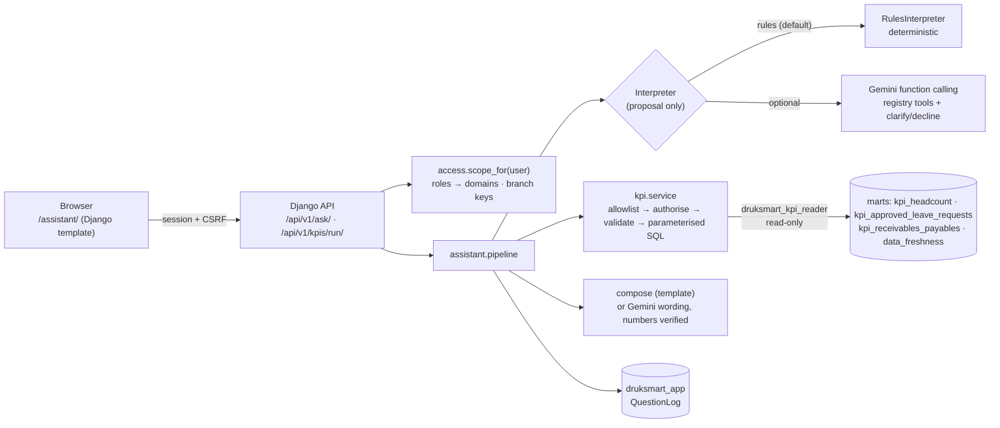

# Django backend: approved KPI service and bounded AI assistant (Milestone 7)

The backend answers HR and Accounts **KPI questions** from validated warehouse data. It does **not**
provide dashboards (that is Superset's job), and it never proxies Superset.

| | |
|---|---|
| Framework | Django **5.2.18 LTS** (plain JSON views, no REST framework: 6 endpoints do not justify it) |
| Runs | `python backend/manage.py runserver 127.0.0.1:8000` (development server; prototype) |
| App metadata | PostgreSQL `druksmart_app` as the `app` role: users, roles, branch scopes, question log |
| Warehouse | `druksmart_kpi_reader`: SELECT on the **4 approved relations** in `backend/approved_datasets.yml`; read-only sessions with a 15 s timeout |
| Interpreters | **rules** (deterministic, no LLM), working · **Gemini** (function calling), implemented and tested with a mocked API, **not yet verified against the real service** (no API key on the reference machine) |

Contents:
1. [Architecture](#1-architecture)
2. [Setup](#2-setup-windows)
3. [API endpoints](#3-api-endpoints)
4. [KPI function registry](#4-kpi-function-registry)
5. [Question workflow](#5-question-workflow)
6. [Security boundaries](#6-security-boundaries)
7. [AI provider (Gemini) configuration](#7-ai-provider-configuration-gemini)
8. [Supported questions](#8-supported-questions)
9. [Tests and evaluation](#9-tests-and-evaluation)
10. [Limitations](#10-known-limitations)

## 1. Architecture



| Django app | Responsibility |
|---|---|
| `access` | Roles (Django groups named like the Superset roles), `BranchScope`, `scope_for(user)`, demo-user commands |
| `kpi` | `registry.py` (the allowlist), `service.py` (validation, authorisation, queries), `warehouse.py` (restricted connection), KPI API |
| `assistant` | `rules.py`, `gemini.py`, `pipeline.py`, `compose.py`, the UI page, `QuestionLog`, `evaluate_assistant` command |
| `health` | `/health/` (alive) and `/health/ready/` (app DB, warehouse freshness, AI provider) |

## 2. Setup (Windows)

```powershell
pip install -e ".[dev,backend]"                       # Django 5.2.18, pytest-django
python infrastructure\scripts\create_local_env.py --add-missing   # DJANGO_SECRET_KEY, KPI reader password, ...
docker compose exec -T postgres bash /docker-entrypoint-initdb.d/01_init_databases_roles_schemas.sh
python warehouse\publish.py grant-consumers           # KPI reader grants (Airflow does this at every publication)
python backend\manage.py migrate                      # Django tables in druksmart_app
python backend\manage.py seed_demo_users              # LOCAL ONLY: demo_hr (HR Manager), demo_accounts (Accounts Manager), demo_executive, demo_branch
python backend\manage.py createsuperuser              # optional administrator (you type the password)
python backend\manage.py runserver 127.0.0.1:8000
```

The new dbt view `kpi_approved_leave_requests` must be published first: run the Airflow DAG once, or
a manual `python warehouse\run_dbt.py build` in development.

**Expected results:**
- <http://127.0.0.1:8000/health/ready/> returns `{"status": "ok", ...}`.
- <http://127.0.0.1:8000/> shows the login page. Demo users use the password in `BACKEND_DEMO_USER_PASSWORD` in your `.env`; never share it in chat.

| Problem | Fix |
|---|---|
| `DJANGO_SECRET_KEY is not set` | `create_local_env.py --add-missing` |
| `/health/ready/` warehouse `InsufficientPrivilege` | `python warehouse\publish.py grant-consumers` (or the KPI view is not published yet) |
| `password authentication failed for user "druksmart_kpi_reader"` | Re-run the init script (it sets the password from `.env`) |
| Port 8000 busy | `runserver 127.0.0.1:8001` |

## 3. API endpoints

All `/api/v1/` endpoints use Django **session authentication**: log in at `/accounts/login/`. POSTs
need the CSRF token (header `X-CSRFToken`). Unauthenticated calls get **401 JSON**.

| Method | Path | Body | Returns |
|---|---|---|---|
| GET | `/health/` | | `{"status": "ok"}` (no login) |
| GET | `/health/ready/` | | app DB, warehouse data dates, AI provider; 503 if degraded (no login, no secrets) |
| GET | `/api/v1/me/` | | user's roles, domains, branch restriction |
| GET | `/api/v1/kpis/` | | registry functions available to the user's domains |
| POST | `/api/v1/kpis/run/` | `{"function": "hr.active_headcount", "group_by": "department", "as_of": "2026-10-24", "filters": {"branch": "Paro"}}` | `{"status": "ok", "result": {...}}` or 400 `invalid_filter`, 403 `forbidden`, 404 `no_data` / `unsupported`, 503 `error` |
| POST | `/api/v1/ask/` | `{"question": "How much is overdue?"}` | always 200 with `status` (below), `answer`, `interpreter`, `llm_used`, `phrasing`, `function`, `parameters`, `result`, `options`, `details`, `notes` |
| GET | `/` or `/assistant/` | | the question page (login required) |

The `/api/v1/ask/` `status` values are:
- `answered`
- `clarification_needed`
- `unsupported`
- `forbidden`
- `invalid_filter`
- `no_data`
- `invalid_request`
- `error`

A `result` contains:
- `function`, `kpi_ids`, `title`, `dataset`;
- `as_of` or `period`;
- `group_by`, `filters`, `branch_restricted`;
- `columns` (name, label, unit), `rows`;
- `freshness` (per source instance) and `notes`.

## 4. KPI function registry

`backend/kpi/registry.py` is the **allowlist**. Nothing else can be executed. All functions read
published, tested datasets. Every measure is a fixed aggregate over a governed KPI column, identical
to the certified Superset metric (tested).

| Function | Module | KPI | Dataset | Date parameter | Group-by (optional) | Filters | Output measures |
|---|---|---|---|---|---|---|---|
| `hr.active_headcount` | HR | HR-01, HR-02 | `kpi_headcount` | `as_of` (default latest snapshot) | department, branch, organisation, employee_category | organisation, branch, department, employee_category | `active_headcount` (count) |
| `hr.employment_status` | HR | HR-01 | `kpi_headcount` | `as_of` | (always by employment_status) | organisation, branch, department | `employee_records` (count) |
| `hr.approved_leave` | HR | HR-03 | `kpi_approved_leave_requests` | `period_start`/`period_end` (default: month of latest HR data; ≤ 731 days) | leave_type, department, branch, organisation, month | organisation, branch, department, leave_type | `employees_on_leave` (distinct, not additive), `approved_requests`, `approved_leave_days` |
| `ac.outstanding_receivables` | Accounts | AC-01 | `kpi_receivables_payables` (ledger = receivable) | `as_of` | organisation, branch, ageing | organisation, branch, currency | `outstanding_amount` (amount, per currency), `open_documents` |
| `ac.outstanding_payables` | Accounts | AC-02 | same (ledger = payable) | `as_of` | organisation, branch, ageing | organisation, branch, currency | same |
| `ac.overdue_balance` | Accounts | AC-03 | `kpi_receivables_payables` | `as_of` | organisation, branch | organisation, branch, ledger, currency | `overdue_amount` per ledger and currency |
| `ac.overdue_by_ageing` | Accounts | AC-03, AC-04 | `kpi_receivables_payables` | `as_of` | (always ledger × ageing) | organisation, branch, ledger, currency | `overdue_amount` (non-zero buckets) |
| `ac.ageing` | Accounts | AC-04 | `kpi_receivables_payables` | `as_of` | (always ledger × ageing) | organisation, branch, ledger, currency | `outstanding_amount` |

**Validation rules (service.py):**
- Unknown function → `unsupported`.
- Domain not in the user's role → `forbidden`. This is checked **before any connection** to the warehouse.
- Group-by or filter dimension not declared by the function → `invalid_filter`.
- Filter values are matched case-insensitively against the organisation structure in the governed datasets:
  - an unknown value → `invalid_filter`, with the valid values;
  - a real value **outside the user's branch scope** → `forbidden`, never silently dropped.
- An `as_of` that is not an extracted snapshot date → `no_data`, with the available dates. History is never reconstructed.
- No matching rows → `no_data`.
- **Amounts are always split by currency** and never added across currencies.

Queries are composed with `psycopg.sql` from registry **constants** (identifiers, aggregate
expressions). Every user or model value is a **bound parameter**. The user's branch keys are always
ANDed in (`branch_key = ANY(%s)`).

## 5. Question workflow

1. **Validate** the question: non-empty, ≤ 500 characters.
2. **Scope:** `scope_for(user)` derives domains and branch keys from Django groups and `BranchScope`. Users without a role are refused.
3. **Interpret.** The rules or Gemini interpreter produce a *proposal*: a function plus parameters, `clarify`, or `unsupported`. Sensitive questions (personal data, individual records, writes, SQL, forecasts, other modules) are refused **before** any KPI is considered.
4. **Execute** through the KPI service: allowlist, authorisation, parameter validation, parameterised query on the approved dataset.
5. **Answer:**
   - The deterministic template text is built from the result rows.
   - With Gemini, the model may phrase the answer from the aggregated result. The phrasing is **accepted only if every number in it occurs in the result**; otherwise the template text is shown and the rejection is noted.
6. **Log:** user, question, interpreter, status, function, parameters and duration go to `QuestionLog` (Django admin). No result values are logged.

If Gemini is unreachable or returns no valid tool call, the answer comes from the **rules interpreter**:
- it is labelled `interpreter: "rules (fallback)"`;
- it says `llm_used: false`;
- it carries a note.

It is never presented as an LLM answer.

## 6. Security boundaries

| Boundary | Enforced by | Tested |
|---|---|---|
| Who may ask | Django session login; CSRF on POST | 401 without login; 403 without CSRF token |
| Which domains / branches | `scope_for` (backend), never the model | HR user → Accounts `forbidden` with **zero** warehouse queries; branch manager filters for Paro / DTG Services → `forbidden` |
| What can be executed | Registry allowlist + parameter validation | unknown functions, `sql` parameters, undeclared dimensions rejected |
| How queries are built | `psycopg.sql` constants + bound parameters | SQL-injection strings stay parameters (unit test) |
| What the database account can read | `druksmart_kpi_reader`: SELECT on 4 approved relations only; read-only, 15 s timeout | `permission denied` on `dim_employee`, `fct_leave_request`, `raw.source_record`, `kpi_approved_leave_monthly`; temp-table creation fails read-only |
| What Gemini receives | Question text, reference date, registry tool descriptions with **organisational labels** (department/branch/organisation/leave-type names), and for wording only the aggregated `KpiResult.for_llm()` | Request inspected in tests: no SQL, table names, employee keys, branch keys, credentials (API key only in the header) |
| What Gemini cannot do | Execute anything; decide permissions; return unverified numbers | Proposals go through the same service; invented numbers are rejected (tests) |

The request-grain view `kpi_approved_leave_requests` contains opaque `employee_key`s, which are needed
for HR-03's distinct count. They are aggregated inside PostgreSQL and **never** leave the backend.
Questions asking *who* is on leave are refused.

**Separate logins (prototype limitation):** Superset and Django have their own user databases.
The same role names are used in both, but there is no single sign-on, so a person needs an
account in each, created by an administrator. Each system enforces its own permissions on the
data it queries; neither bypasses the other (CLAUDE.md §2).

## 7. AI provider configuration (Gemini)

The **rules interpreter is the default** and needs nothing. To try Gemini:

1. **Get a key.** Sign in at **<https://aistudio.google.com/apikey>** with a Google account and choose *Create API key*.
   - The free tier is enough for testing. Google may use free-tier prompts to improve its products, so use only the synthetic sandbox data.
   - Paid usage needs a Google Cloud project with billing.
   - Check the current model names at <https://ai.google.dev/gemini-api/docs/models>.
2. **Store it locally only.** Open `.env` in an editor, set `GEMINI_API_KEY=<your key>` and `DRUKSMART_AI_PROVIDER=gemini`, and optionally change `GEMINI_MODEL` (default `gemini-2.5-flash`). Never paste the key into chat, code or Git. `.env` is git-ignored.
3. **Restart** the server, then check that `/health/ready/` shows `"provider": "gemini"`.
4. **Measure it:** `python backend\manage.py evaluate_assistant --provider gemini --output docs\backend\evaluation_gemini.json`. Compare the result with the rules results in [EVALUATION.md](EVALUATION.md).

Settings:

| Setting | Effect |
|---|---|
| `DRUKSMART_AI_PROVIDER` | `rules` (default) or `gemini` |
| `GEMINI_API_KEY` | key from AI Studio; empty disables Gemini |
| `GEMINI_MODEL` | model id (default `gemini-2.5-flash`) |
| `GEMINI_TIMEOUT_SECONDS` | request timeout (default 20) |
| `DRUKSMART_AI_LLM_PHRASING` | `true` lets Gemini word the answer (numbers verified); `false` keeps template answers |

## 8. Supported questions

All seven example questions from the brief are answered and verified against the warehouse:
- How many active employees are there?
- How many employees work in each department?
- How many employees are on approved leave?
- What is the outstanding receivables balance?
- What is the outstanding payables balance?
- How much is overdue?
- Show overdue balances by ageing category.

Also supported:
- filters by organisation, branch, department and leave type;
- a date ("on 2026-10-23") or a month ("in October 2026");
- active vs not active;
- by branch, by leave type, ageing.

Refused by design:
- individuals and names;
- pay, bank and identity details;
- changes to data;
- SQL;
- forecasts;
- revenue, inventory, payroll and other modules.

**"Employees on approved leave"** follows the KPI catalogue (HR-03): distinct employees whose
approved leave **starts** in the period. The default period is the calendar month of the latest HR
data, and the answer states the period.

## 9. Tests and evaluation

| Suite | Count | Result |
|---|---|---|
| `tests/backend/test_registry.py`: allowlist consistency, rejections before any query, injection stays a parameter, Superset-equal metric SQL | 24 | passed |
| `tests/backend/test_rules.py`: phrasings → function/parameters, clarifications, refusals | 37 | passed |
| `tests/backend/test_gemini.py`: mocked API: request content, tool forcing, reply mapping, errors, number verification | 16 | passed |
| `tests/backend/test_api.py`: auth, CSRF, KPI API, forbidden-without-query, pipeline statuses, fallback labelling, LLM text rejection | 24 | passed |
| `tests/backend/test_kpi_warehouse.py` (`-m backend`): every function vs independent fact-table SQL, branch scope, read-only account | 17 | passed |
| `tests/backend/test_superset_consistency.py` (`-m superset`): KPI service = Superset chart data (admin and RLS branch manager) | 9 | passed |
| Whole repository `pytest` | 482 | **482 passed** |
| Assistant evaluation (rules) | 56 + 14 held-out | see [EVALUATION.md](EVALUATION.md) |
| Browser (headless Edge): login, answer with context table, clarification, forbidden | 4 questions | rendered as expected (screenshots in `docs/backend/screenshots/`) |
| Live HTTP: 7 brief questions + 5 edge cases as executive; HR / Accounts / branch boundaries | 21 requests | all as expected |

## 9a. Freshness and error contract (Milestone 8)

- **Stale results.** Every KPI result carries `hours_since_publication` and `stale` (older than
  `DRUKSMART_STALE_AFTER_HOURS`, default 30 h, or never published). A stale answer keeps its value but
  appends a WARNING to the answer text, and the UI shows "Answer from OUT-OF-DATE data".
- **Readiness.** `/health/ready/` returns 503 while the data is stale.
- **Error contract.** `kpi.middleware.ApiErrorMiddleware` keeps the JSON error contract for `/api/` even when the
  database is down (503 `{"status": "error"}`, no data).

## 10. Known limitations

- **Gemini is not verified live.** No API key was available on the reference machine. The integration is tested only with a mocked HTTP API, so the real model's accuracy is **unknown** until `evaluate_assistant --provider gemini` is run with a key.
- **The rules interpreter is brittle.** It scored 13/14 on new held-out phrasings (EVALUATION.md). For example, "How much are customers late in paying?" returned both ledgers instead of receivables only. Phrasings without a rule end as `clarification_needed` or `unsupported`.
- **One question, one KPI.** There are no multi-step questions, comparisons ("vs last month"), trends or percentages.
- **Separate Superset and Django accounts** (no SSO). Branch scopes are configured manually per user.
- **Development server only.** A deployment needs a WSGI server, HTTPS, secure cookies, `collectstatic` and logging; `manage.py check --deploy` lists the 4 remaining HTTPS warnings.
- **Sandbox data.** Answers come from sandbox/synthetic data; nothing has been verified against DrukSmart's ERPs.
- **Question text is sent to Gemini** when Gemini is enabled. Users could type personal data into it. The UI asks for KPI questions only, and the question is stored in the app DB's `QuestionLog`.
