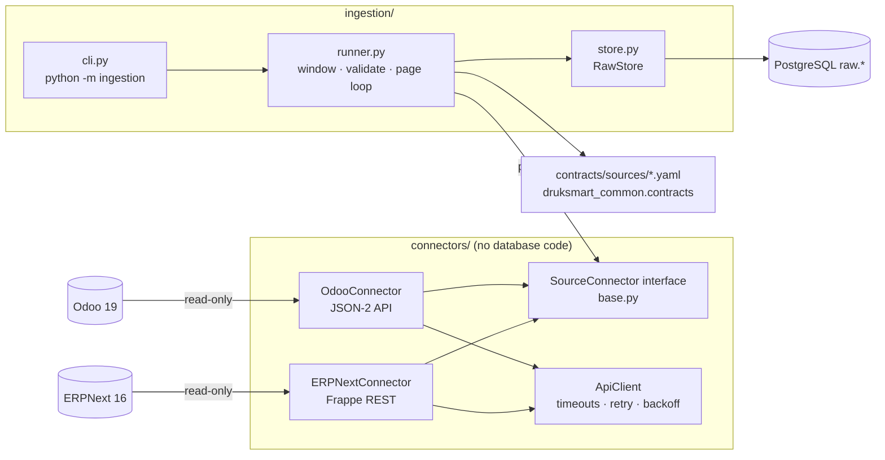

# ERP Integration Framework: connectors and raw ingestion

Status: Milestone 3. See [§9](#9-verification-status) for what is verified live versus with mocks only.

## 1. Architecture

* **Connectors** only call ERP APIs and yield pages of records. They do not import psycopg and know
  nothing about the database (interface independent of downstream models).
* **Ingestion** decides the extraction window, validates every record against the source contract,
  and stores results and checkpoints.

## 2. Connector interface (`connectors/base.py`)

| Operation | Method | Notes |
|-----------|--------|-------|
| Validate connection + authenticate | `check_connection() -> ConnectionReport` | Reachability, auth, server version (supported majors: Odoo 19, ERPNext 16), HRMS presence |
| Discover / validate entities | `entities(module)`, `validate_entity(entity) -> EntityCheck` | Confirms each contracted field exists **and is readable by this user** |
| Fetch records + pagination | `fetch_pages(entity, window, page_size, start_after) -> Iterator[Page]` | Keyset pagination on the primary key; ascending order |
| Fetch modified records | `ExtractionWindow(modified_after, modified_until)` | `(after, until]` on Odoo `write_date` / ERPNext `modified` |
| Checkpoints | `CheckpointStore` protocol | Implemented by `ingestion.store.RawStore` |
| Status reporting | `ConnectionReport`, `EntityCheck`, runner `ExtractionResult` | Also persisted in `raw.extraction_run` |
| Retries and errors | `ApiClient` + error hierarchy | See §5 |

Error types: `AuthenticationError`, `PermissionDeniedError`, `EntityNotFoundError`,
`InvalidRequestError`, `TransientError` / `RetryExhaustedError`, `ResponseFormatError`,
`ReadOnlyViolationError`, `UnsupportedEntityError`.

## 3. Adapters

### Odoo 19 (`connectors/odoo.py`)
* `POST /json/2/<model>/search_read` with `Authorization: bearer <api key>` and optional `X-Odoo-Database`.
* Body: `domain`, `fields` (contracted fields only), `limit`, `order: "id asc"`, `context` (e.g. `active_test: false`).
* Pagination: `["id", ">", last_id]` keyset plus `limit`. Stops on a short or empty page.
* Version: `GET /web/version`. Auth check: `res.users/context_get`. Field access: `fields_get`, which omits fields the user may not read.
* **Read-only guard:** only `search_read`, `search_count`, `fields_get` and `context_get` can be called. Anything else raises `ReadOnlyViolationError` *before* a request is sent.
* **No paid feature assumed.** The JSON-2 API is part of Odoo 19 Community (`addons/rpc`). On *Odoo Online*, external API access needs a Custom plan. Self-hosted Community has no such restriction.

### ERPNext 16 (`connectors/erpnext.py`)
* `GET /api/resource/<DocType>` with `Authorization: token <api_key>:<api_secret>`.
* Params: `fields` (JSON list), `filters` (JSON list), `order_by=name asc`, `limit_start=0`, `limit_page_length` **always explicit** (Frappe defaults to 20).
* Pagination: `["name", ">", last_name]` keyset.
* Datetime filters are converted from UTC to the **site time zone** (`ERPNEXT_TIMEZONE`), because Frappe stores naive local times.
* Child tables (Payment Entry `references`): one `GET /api/resource/<DocType>/<name>` per document, projected to the contracted fields.
* Version and app check: `frappe.utils.change_log.get_versions`. Auth: `frappe.auth.get_logged_user`. Fields: `GET /api/v2/doctype/<DocType>/meta`.
* **Read-only guard:** the adapter only sends `GET`.

## 4. Raw storage and idempotency (`ingestion/migrations/001_raw_tables.sql`)

| Table | Purpose |
|-------|---------|
| `raw.extraction_run` | Extraction log: one row per entity attempt (window, mode, status, counters, error, keyset cursor) |
| `raw.source_record` | Append-only **record versions**: source ERP, instance, entity, source id, original JSON payload, SHA-256, source modification time (UTC), contract version, warnings, first/last run and time, times seen |
| `raw.quarantined_record` | Records that broke the contract (never promoted), with issues |
| `raw.extraction_checkpoint` | Last successful `window_until` per (system, instance, entity) |
| `raw.current_source_record` (view) | Latest version of every record |

**Idempotency / history strategy.** Each row's identity is
`(source_system, source_instance, source_entity, source_id, payload_sha256)`:
* Re-extracting an identical record updates only `last_run_id`, `last_extracted_at` and `times_seen`, so no rows are added.
* A changed record inserts a **new version** row. Earlier versions are kept for audit and history.
* The current state is the version with the latest `last_extracted_at`. This also handles A→B→A changes.
* Duplicate ids within one run are counted (`records_duplicate`) and stored once.
* An advisory lock prevents two concurrent runs of the same entity.

**Payload.** The payload is the record exactly as returned by the API for the contracted fields
(ERPNext child documents are projected to their contracted fields). Values are not renamed or
type-converted in `raw`; conversion happens in dbt staging.

## 5. Incremental extraction, failures and recovery

| Situation | Behaviour |
|-----------|-----------|
| First run / `--full` | Window `(None, now]`; mode `full` |
| Later runs | Window `(checkpoint − 10 min, now]`. The overlap catches late commits and clock skew; re-fetched records are just `unchanged` |
| Records changing during a run | Upper bound = run start, so they are picked up next run. Keyset paging means other rows never shift |
| Timeouts, connection errors, HTTP 429/502/503/504 | Retried up to 5 attempts with exponential backoff (1, 2, 4, 8 s + jitter, max 30 s); `Retry-After` honoured |
| 401 / 403 / 404 / invalid field | Not retried; run marked `failed` with the error |
| Interrupted run | Every page is committed separately; the run is marked `failed`; the checkpoint is **not** advanced. The next run re-fetches from the previous checkpoint, and stored pages count as `unchanged` |
| Invalid records | Quarantined; the run still succeeds. A fixed record in the ERP gets a newer modification time and is re-extracted |
| **Deletions** | **Not detected.** Neither API exposes deletion events. Odoo archived records are captured (`active_test: false`); ERPNext cancellations appear as `docstatus = 2`. Hard deletes stay in raw until a future full-reconciliation feature exists |

## 6. Commands

Run from the repository root with `.venv` activated and PostgreSQL running.

| Task | Command |
|------|---------|
| Create/upgrade raw tables | `python -m ingestion migrate` |
| Test an ERP connection (+ entity access) | `python -m ingestion check --source odoo` / `--source erpnext` |
| Extract HR records | `python -m ingestion extract --source odoo --module hr` |
| Extract Accounts records | `python -m ingestion extract --source erpnext --module accounts` |
| One entity, full re-extraction | `python -m ingestion extract --source erpnext --entity "Sales Invoice" --full` |
| Inspect the extraction log | `python -m ingestion runs` (`--failed`, `--source`, `--limit`) |
| Verify raw contents | `python -m ingestion summary` · `python -m ingestion quarantine` |
| Re-run safely | Run the same `extract` command again; identical records are counted as `unchanged` |
| Verbose page-by-page logging | add `-v` before the sub-command, e.g. `python -m ingestion -v extract ...` |

Exit codes: `0` success, `1` a check or extraction failed, `2` configuration error.

## 7. Credentials and configuration

Set in `.env` (never committed; see `.env.example`):

| Variable | Meaning |
|----------|---------|
| `ODOO_INSTANCE_ID`, `ERPNEXT_INSTANCE_ID` | Stable label stored on every raw row. One per ERP installation |
| `ODOO_BASE_URL`, `ERPNEXT_BASE_URL` | `https://` required unless the host is local |
| `ODOO_DATABASE` | Sent as `X-Odoo-Database` (multi-database servers) |
| `ODOO_API_KEY` | API key of the dedicated Odoo bot user (max 3 months validity) |
| `ERPNEXT_API_KEY`, `ERPNEXT_API_SECRET` | API key pair of the dedicated read-only ERPNext user |
| `ERPNEXT_TIMEZONE` | Site time zone (System Settings), default `Asia/Thimphu` |
| `DRUKSMART_HTTP_TIMEOUT_SECONDS`, `DRUKSMART_PAGE_SIZE` | Optional tuning (30 s, 200) |

**Required ERP permissions**
* **ERPNext:** a user whose only role grants **read** on Company, Branch, Department, Employee, Leave Application,
  Customer, Supplier, Sales Invoice, Purchase Invoice and Payment Entry. The ERP enforces read-only access.
* **Odoo:** a dedicated internal user with *Employees: Officer*, *Time Off: Officer* and *Accounting: Read-only*.
  Odoo has **no read-only HR group**, yet `employee_type` and `departure_date` are restricted to HR officers, who can also
  edit employees. Read-only access for HR is therefore enforced by the connector's method whitelist, not by Odoo
  (DrukSmart decision **DS-SEC-01**).

## 8. Supported versions and known restrictions

| Item | Status |
|------|--------|
| Odoo | 19.x only (JSON-2 is new in 19.0; older versions need XML-RPC and a new contract) |
| ERPNext / HRMS | 16.x; Leave Application requires the **hrms** app |
| Odoo exact payment allocations (`account.partial.reconcile`) | Contracted, not extracted (deferred) |
| Deletions | Not detected (see §5) |
| ERPNext child tables | One extra request per document (Payment Entry only) |
| Throughput | Sequential; one entity at a time per process |

## 9. Verification status

Live = local sandboxes (Odoo 19.0-20261015 Community; ERPNext 16.52.0 + HRMS 16.52.0), 2026-10-22.
**Not verified against DrukSmart's own ERP instances** (no access yet).

| Capability | Controlled (fake API) tests | Live sandbox |
|------------|-----------------------------|--------------|
| Authentication success / failure | ✅ | ✅ success; ✅ Odoo wrong key → 401 |
| Version check | ✅ | ✅ Odoo `19.0-20261015`, ERPNext `16.52.0`, HRMS detected |
| Every contracted field readable by the read-only user | ✅ | ✅ all 7 Odoo + 10 ERPNext entities |
| Real payloads satisfy the contracts | n/a | ✅ 0 errors after one contract fix (ERPNext root Department has no company) |
| Pagination (keyset, multi-page) | ✅ | ✅ page size 2 returns every employee exactly once |
| Incremental extraction | ✅ | ✅ one edited record per ERP → exactly 1 new version |
| Idempotent re-run | ✅ (DB) | ✅ second run: 0 new versions |
| ERP refuses writes by the read-only user | n/a | ✅ Odoo (company/invoice), ERPNext (create/update) |
| Timeouts, 429/5xx retry + backoff, Retry-After | ✅ | not induced live |
| Interrupted run → recovery without duplicates | ✅ (DB) | not induced live |
| Concurrent run refused (advisory lock) | ✅ (DB) | not induced live |
| Odoo `active_test=false` returns archived records | ✅ | ✅ |
| ERPNext child tables via single GET | ✅ | ✅ |
| ERPNext site time zone for filters | ✅ | ✅ `Asia/Thimphu` |
