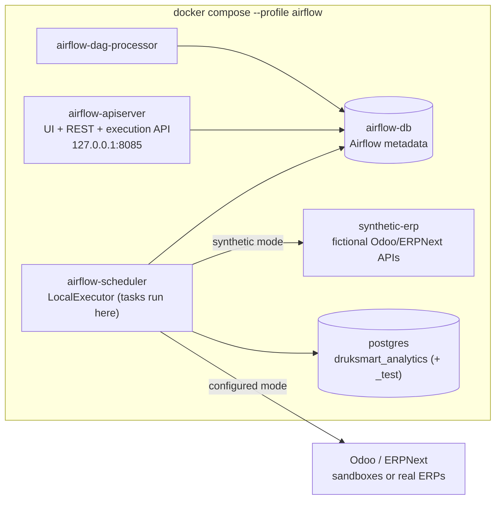
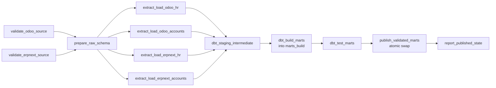

# Orchestration (Apache Airflow 3.3.2)

Status: Milestone 5. One DAG, `druksmart_elt`, orchestrates the existing components:
connectors and ingestion (`python -m ingestion`), dbt (`warehouse/run_dbt.py`) and publication
(`warehouse/publish.py`). The DAG holds **no business logic**. Every task runs
`orchestration/bin/run_step.sh <step>`.

## 1. Runtime architecture



| Choice | Why |
|--------|-----|
| Airflow **3.3.2**, image `apache/airflow:3.3.2-python3.12` | Current stable release; supports Python 3.12 and PostgreSQL 14–18 |
| **LocalExecutor**, no Redis/Celery/triggerer | Student laptop: about 1.5 GB RAM for Airflow instead of 3–4 GB; no deferrable tasks are needed |
| **Separate `airflow-db` container** | Airflow metadata never shares the analytics warehouse. A warehouse outage does not take Airflow down (so it can retry and report) |
| **Separate pipeline venv** `/opt/druksmart-venv` inside the image | dbt and pipeline packages never conflict with Airflow's own pinned dependencies |
| Pipeline code mounted **read-only** at `/opt/druksmart` | Same code as on the host. Edits apply without rebuilding the image |
| Offline image build from `orchestration/docker/wheels/` | Reproducible on slow networks; wheels are pre-downloaded (§9) |

## 2. DAG structure



| Task | Command (run_step.sh) | Retries | Timeout | Notes |
|------|-----------------------|---------|---------|-------|
| `validate_<erp>_source` | `check <erp>` | 2 | 5 min | Connection, auth, version, contracted field access |
| `prepare_raw_schema` | `migrate` | 2 | 5 min | Applies pending raw migrations |
| `extract_load_<erp>_<module>` | `extract <erp> <hr\|accounts>` | 3 | 30 min | Pools `odoo_api` / `erpnext_api` (1 slot each): never two extractions against the same ERP at once; Odoo and ERPNext run in parallel |
| `dbt_staging_intermediate` | `dbt build --select seeds staging intermediate` | 1 | 30 min | Includes their data tests |
| `dbt_build_marts` | `dbt run --select path:models/marts --vars {marts_schema: marts_build}` | 1 | 30 min | Builds into the **hidden** `marts_build` schema |
| `dbt_test_marts` | `dbt test … --vars …` | 0 | 30 min | Deterministic, so no retry. Failure blocks publication |
| `publish_validated_marts` | `publish {{ run_id }}` | 2 | 5 min | Atomic swap, freshness stamp, audit row |
| `report_published_state` | `report` | 0 | 5 min | Logs freshness and raw summary |

Retry delays grow exponentially from 1 min (max 10 min). DAG run timeout: 2 h. `max_active_runs=1`.
HTTP-level retries inside the connectors (5 attempts, backoff) happen *before* an Airflow task retry.

## 3. Publication: never expose unvalidated KPIs

1. Staging and intermediate are rebuilt in place. They are invisible to BI and AI.
2. Marts and KPI views are built into `marts_build` (the BI reader has no access).
3. All mart and singular data tests run against `marts_build`.
4. Only if 1–3 succeeded, `publish_validated_marts` performs **one transaction**: grant the BI reader on
   `marts_build`, rename `marts → marts_previous`, `marts_build → marts`, drop the old one, re-create default
   privileges, stamp `marts.data_freshness` (published_at, pipeline_run_id, source_mode) and insert a row
   into `raw.publication`.

If any task fails, publication does not run: **the previously published marts stay unchanged** and
`marts.data_freshness.published_at` keeps showing their age. A failed run's `marts_build` is left
for diagnosis and replaced by the next run.

## 4. Source modes (synthetic vs configured)

| | `configured` | `synthetic` |
|---|---|---|
| Sources | `ODOO_*` / `ERPNEXT_*` settings (real ERPs or local sandboxes via `host.docker.internal`) | `synthetic-erp` service: **fictional** fixture data through the same Odoo/Frappe APIs |
| Database | `DRUKSMART_ANALYTICS_DB` | `DRUKSMART_ANALYTICS_DB` + `_test` (isolated) |
| Code path | real connectors, ingestion, dbt, publish | **identical** |
| `as_of` param | refused | replays the fixture timeline, e.g. `2026-09-30T17:30:00Z`, `2026-10-31T17:30:00Z` |

Default mode: `DRUKSMART_SOURCE_MODE` in `.env`. Per run: the `source_mode` parameter when triggering.
The synthetic values live in `orchestration/synthetic_mode.env` (fixed test keys, not secrets).

## 5. Scheduling and freshness

* Schedule: `DRUKSMART_ELT_SCHEDULE` (cron, Asia/Thimphu), default `0 2 * * *` (daily 02:00), or `none`.
  `catchup=False`: a missed day is covered by the next run's incremental window.
* This is **scheduled batch refresh**, not real-time integration. Published data is at most
  one schedule interval plus the run duration old, and older if a run fails.
* Check freshness:
  ```powershell
  docker compose exec airflow-scheduler bash /opt/druksmart/orchestration/bin/run_step.sh report
  ```
  or query `marts.data_freshness` (readable by the BI reader): `latest_snapshot_date`,
  `published_at`, `pipeline_run_id`, `source_mode` per instance and domain.
  `raw.publication` keeps the full publication history.

## 6. Operating the pipeline

Prerequisites: Docker Desktop running, `.env` complete (`create_local_env.py --add-missing`).

| Task | Command (PowerShell, repo root) |
|------|---------------------------------|
| Build image (first time / after requirement changes) | `docker compose --profile airflow build` |
| Start Airflow | `docker compose --profile airflow up -d` |
| UI | http://127.0.0.1:8085 (user `AIRFLOW_ADMIN_USER`, password `AIRFLOW_ADMIN_PASSWORD` from `.env`) |
| Check for DAG import errors | `docker compose exec airflow-scheduler airflow dags list-import-errors` |
| Unpause | `docker compose exec airflow-scheduler airflow dags unpause druksmart_elt` |
| Trigger (configured) | `docker compose exec airflow-scheduler airflow dags trigger druksmart_elt` |
| Trigger (synthetic replay) | `docker compose exec airflow-scheduler airflow dags trigger druksmart_elt -c '{"source_mode": "synthetic", "as_of": "2026-10-31T17:30:00Z"}'` |
| Run status | `docker compose exec airflow-scheduler airflow dags list-runs druksmart_elt` |
| Task states of a run | `docker compose exec airflow-scheduler airflow tasks states-for-dag-run druksmart_elt <run_id>` |
| Extraction log (DB) | `python -m ingestion runs` (host) |
| Stop (keep history) | `docker compose --profile airflow stop` |

### Inspecting failures
1. UI → DAG → failed run → red task → **Logs** (each try is kept). The first lines show `[step] mode=… database=…`.
2. Extraction failures: `python -m ingestion runs --failed` shows the error type and message per entity;
   `python -m ingestion quarantine` lists records rejected by the contracts.
3. dbt failures: the task log shows the failing model or test, with `Got N results` for test failures.

### Rerunning safely
* **Re-trigger the DAG, or clear the failed task** in the UI ("Clear" → downstream). Extraction is
  idempotent: identical records become `unchanged`, the checkpoint only advances after success, and
  advisory locks refuse concurrent extraction of the same entity.
* dbt models are rebuilt from raw every run, so they are idempotent by construction.
* Never edit raw tables by hand to "fix" data. Fix the source and let the next run pick it up.

## 7. Troubleshooting

| Symptom | Likely cause | Fix |
|---------|--------------|-----|
| UI not reachable | API server still starting (60 s) or port in use | `docker compose ps`; change `AIRFLOW_PORT` |
| `validate_*` fails with "server not reachable" | Sandbox/ERP down (sandboxes do **not** auto-restart after a Docker Desktop restart), or wrong `*_BASE_URL_FROM_DOCKER` | `python infrastructure\sandboxes\sandbox.py up odoo` / `up erpnext`, then clear the failed run: `airflow tasks clear druksmart_elt --start-date <logical date> --end-date <logical date> --only-failed --downstream --yes` |
| A scheduled run failed overnight | Any of the below | Published data is unchanged (see `marts.data_freshness`). Fix the cause, then clear the run (above) or trigger a new one |
| `must use https` | Non-local HTTP host | Use https, or add the Docker host name to `DRUKSMART_INSECURE_HTTP_HOSTS` |
| Extract task `refused: … already being extracted` | Another run or a manual extraction holds the lock | Wait; `max_active_runs=1` prevents this between DAG runs |
| `dbt_test_marts` failed | A data-quality rule caught bad data | Read the test name in the log; nothing was published |
| Task killed / OOM | Docker memory too low | Docker Desktop → Resources: ≥ 6 GB; stop unused containers |
| Image build fails offline | Wheels missing | Re-run the wheel download (§9) |

## 7a. Container environment (Milestone 8, least privilege)

Airflow containers receive ONLY the variables listed in `compose.yaml` (pipeline DB role, ERP read-only
keys, consumer account names). The repository's `.env` is masked inside them by
`orchestration/docker/no-secrets.env`. After adding a setting the pipeline needs, add it to the
`x-airflow-common` environment list and recreate the containers. Milestone 8 re-ran the recovery
scenarios in the integrated system: see docs/evaluation/EVALUATION_REPORT.md §6.

## 8. Verified behaviour (Milestone 5, 2026-10-22 … 24)

| Run id | Scenario | Result |
|--------|----------|--------|
| `scheduled__2026-10-21T20:00…` | First scheduled run (configured: local Odoo/ERPNext sandboxes) | success |
| `synthetic_2026-09-30`, `synthetic_2026-10-31` | Synthetic replay of both fixture dates | success; published marts equal `expected_kpis.json` (headcount 9+7; AR 117,500/43,000 and 142,500/78,700; AP 54,000/33,000 and 33,200/30,000) |
| `synthetic_2026-10-31_rerun` | Same batch again (incremental) | success; 0 records fetched, raw 127 versions unchanged |
| `synthetic_2026-10-31_full_rerun` | Same batch, `full_refresh` | success; 124 fetched, **0 new**, 117 unchanged, 7 quarantined; KPIs unchanged |
| `fail_erp_unavailable` | synthetic-erp stopped, then restarted | validate tasks `up_for_retry` → attempt 2 succeeded → run success |
| `fail_database_down` | warehouse PostgreSQL stopped, then restarted | `prepare_raw_schema` `up_for_retry` → success; Airflow unaffected (own metadata DB) |
| `fail_dbt_transformation` | staging model broken | `dbt_staging_intermediate` failed; downstream `upstream_failed`; **published marts unchanged** |
| `fail_data_quality` | raw leave for a non-existent employee injected (passes the contract) | marts built; `dbt_test_marts` failed (`relationships_fct_leave_request_employee_key…`); **not published**: bad row only in `marts_build` |
| `recovery_after_failures` | Bad data removed | success; published again, KPIs unchanged |
| `configured_manual_1` | Manual configured run | success; dev marts stamped `configured` |
| `scheduled__2026-10-22T20:00…` | Unattended daily run | success |
| `scheduled__2026-10-23T20:00…` | **Real incident:** Docker Desktop restarted, ERP sandboxes stayed down | validate failed → nothing published (consumers kept the 23 Oct data); after `sandbox.py up`, **cleared** → success |

Invalid source records (the 7 deliberate fixture errors) are quarantined, and the run still publishes.

## 9. Building the image on a slow network

```powershell
python -m pip download --only-binary=:all: --platform manylinux_2_28_x86_64 `
  --platform manylinux_2_17_x86_64 --platform manylinux2014_x86_64 --python-version 3.12 `
  --implementation cp -d orchestration\docker\wheels -r orchestration\docker\requirements-pipeline.txt
docker compose --profile airflow build
```
`orchestration/docker/wheels/` is git-ignored. Re-run the download whenever the requirements change.
