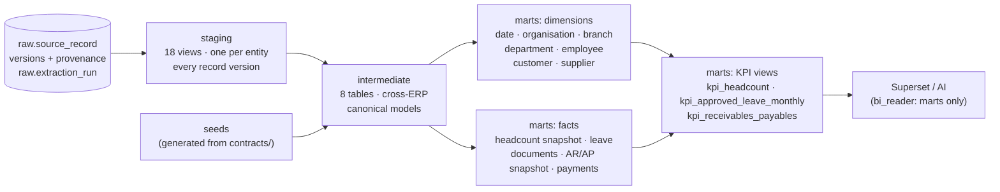

# Analytical Data Warehouse (dbt Core, Kimball)

Status: Milestone 4 (KPI view labels added in Milestone 6). dbt Core 1.12.0 + dbt-postgres 1.11.0, project in `warehouse/`:
43 models (18 staging, 8 intermediate, 7 dimensions, 5 facts, 4 KPI views + data_freshness), 8 generated seeds,
164 dbt data tests on 43 models (dbt `ls` count, Milestone 8; incl. KPI-view grain/label tests from Milestones 6–7).

## 1. Layers



| Layer | Schema | Materialisation | Naming | Purpose |
|-------|--------|-----------------|--------|---------|
| Sources | `raw` | (ingestion) | `source_record`, `extraction_run` | Original API JSON with provenance, never modified by dbt |
| Seeds | `staging` | table | `map_*`, `verified_entity_mappings` | Documented mappings **generated** from `contracts/` (`warehouse/scripts/generate_seeds.py`) |
| Staging | `staging` | view | `stg_<erp>__<entity>` | Typed, renamed columns; ERP empty values (`false`, `""`) → NULL; canonical keys; **one row per record version** with `valid_from` / `valid_to` / `is_current` |
| Intermediate | `intermediate` | table | `int_*` | Odoo + ERPNext combined into canonical models using the seeds; explicit `unassigned` / `ambiguous` handling |
| Marts | `marts` | table | `dim_*`, `fct_*` | Kimball star schemas |
| KPI | `marts` | view | `kpi_*` | Governed KPI datasets for Superset and AI |

Only `marts` is readable by `bi_reader` (Superset, AI). PostgreSQL views run with their owner's
rights, so KPI views work without granting access to staging or intermediate.

## 2. Keys and identity

* Every key is `"<source_system>:<source_instance>:<source id>"`, e.g. `odoo:odoo-dtg-retail:101`,
  `erpnext:erpnext-dtg-services:HR-EMP-00001`. Keys never collide across ERPs or instances.
* `unassigned` members (`…:unassigned`) exist for every instance in `dim_branch` and `dim_department`,
  so missing references stay visible instead of disappearing.
* Cross-ERP identity only through `verified_entity_mappings` (from `contracts/mappings/entity_mappings.yaml`):
  `dim_customer.unified_customer_id` / `fct_receivable_payable_snapshot.unified_counterparty_id`.

## 3. Star schemas and grains

### HR

| Fact | Type | Grain | Measures | Dimensions |
|------|------|-------|----------|------------|
| `fct_headcount_snapshot` | Periodic snapshot | One row per **employee per HR snapshot date** per source instance (all statuses) | `headcount` (1 if active) | date (snapshot), employee, department, branch, organisation |
| `fct_leave_request` | Transaction | One row per **leave request** per source instance (latest version) | `leave_days`, `request_count` | date (start), employee, department, branch, organisation |

### Accounts

| Fact | Type | Grain | Measures | Dimensions |
|------|------|-------|----------|------------|
| `fct_receivable_payable_snapshot` | Periodic snapshot | One row per **posted document with non-zero outstanding per accounts snapshot date** per source instance | `outstanding_company`, `days_overdue`, `ageing_bucket` | date (snapshot), customer/supplier (via `counterparty_key`, `unified_counterparty_id`), branch, organisation |
| `fct_accounting_document` | Transaction | One row per **invoice / vendor bill / credit note** (latest version, all states) | `amount_total_company` (document value), `current_outstanding_company` | date (document, due), counterparty, branch, organisation |
| `fct_payment` | Transaction | One row per **payment** (latest version) | `amount`, `unallocated_amount` | date (payment), counterparty |

Transaction measures (document totals, payments) and snapshot balances live in **separate facts**.
`amount_total_company` is never used as an outstanding balance.

### Dimensions

| Dimension | Grain | History | Source |
|-----------|-------|---------|--------|
| `dim_date` | One row per calendar date 2015–2035 | n/a | generated |
| `dim_organisation` | Legal company | Type 1 | Odoo root companies, ERPNext companies |
| `dim_branch` | Branch (+ unassigned) | Type 1 | Odoo companies (root = head office), ERPNext Branch |
| `dim_department` | Department (+ unassigned) | Type 1 | Both ERPs; never merged across companies/ERPs |
| `dim_employee` | Employee | **Type 1** | Both ERPs |
| `dim_customer`, `dim_supplier` | Partner record | Type 1 | Odoo partners (by rank), ERPNext Customer/Supplier |

**No SCD Type 2.** No requirement asks for attribute history on its own. The point-in-time
department, branch and status needed for KPIs are stored on the snapshot fact.

## 4. Snapshot policy (no fabricated history)

`int_snapshot_dates` lists, per instance and domain, the **local calendar dates (Asia/Thimphu) on
which every key entity of the domain was extracted successfully**:
HR = Odoo `hr.employee` / ERPNext `Employee`; Accounts = Odoo `account.move` / ERPNext
`Sales Invoice` **and** `Purchase Invoice`.

For a snapshot date D, each record's state is the version first extracted **before the end of D**
(`valid_from < cutoff ≤ valid_to`). Dates without an extraction have **no snapshot**: history starts
with the first extraction and is never rebuilt from current-state records.

Example (synthetic fixtures): HR was extracted only on 2026-10-31 → one HR snapshot; accounts on
2026-09-30 and 2026-10-31 → two AR/AP snapshots.

## 5. KPI implementation

| KPI | Dataset | Definition |
|-----|---------|------------|
| HR-01 Active headcount | `kpi_headcount` | `sum(active_headcount)` at a snapshot date |
| HR-02 By department | `kpi_headcount` | group by `department_key` (unassigned included) |
| HR-03 Approved leave | `kpi_approved_leave_monthly` / `fct_leave_request` | approved requests by start-date month; `employees_on_leave` is distinct (not additive) |
| AC-01 / AC-02 Outstanding AR / AP | `kpi_receivables_payables` | `sum(outstanding_amount)` by `ledger` at a snapshot date |
| AC-03 Overdue | `kpi_receivables_payables` | `sum(overdue_amount)` (positive balances past due date) |
| AC-04 Ageing | `kpi_receivables_payables` | group by `ageing_bucket` (`not_due`, `1_30`, `31_60`, `61_90`, `91_plus`, `no_due_date`, `unapplied_credit`) |
| Advances (DS-AC-07) | `fct_payment` | `sum(unallocated_amount)` for posted received payments; not netted |

**Milestone 6 additions (labels only, KPI definitions unchanged):** the KPI views also carry
display labels from the conformed dimensions (`organisation_name`, `branch_name`, `department_name`;
`currency_code` and a sortable `ageing_bucket_label` on `kpi_receivables_payables`). `kpi_headcount`
adds `employment_status` to its grain (active vs not-active comparison; sums unchanged), and
`kpi_approved_leave_monthly` adds `organisation_key`/`branch_key` (the employee's current ones) for
filtering. Grain (`unique_combination`) and label (`not_null`) tests were added for all three views.
They exposed a Milestone 4 defect, now fixed: ERPNext invoices took their organisation from the
"Unassigned" branch (none). They now use the invoice's own `company`. Superset reads these views
through an approved-dataset list ([../bi/SUPERSET.md](../bi/SUPERSET.md)).

**Milestone 7:** `kpi_approved_leave_requests` is a view of approved leave at request grain (opaque
`employee_key`, org labels, dates, days). It is approved only for the Django KPI service
(`backend/approved_datasets.yml`), which needs it for HR-03's distinct employees over any period,
and is aggregated inside PostgreSQL ([../backend/BACKEND.md](../backend/BACKEND.md)).

Accounting rules (from `contracts/canonical/accounts.yaml`, implemented in `int_accounting_document_versions`):
* only **posted** documents count; drafts and cancelled documents never do, even with a stale balance;
* `sign × abs(source amount)`: invoices +, credit notes −, independent of each ERP's own sign convention;
* partial payments via the ERP-maintained residual / outstanding amount;
* ERPNext outstanding is converted from the party-account currency when needed; anything unconvertible is
  flagged `currency_unresolved` and fails a data test instead of being silently dropped;
* Odoo `invoicing_legacy` documents are excluded (DS-AC-06); documents dated after D are excluded.

## 6. Tests

| Kind | Where | What |
|------|-------|------|
| Generic data tests | `models/**/_*.yml` | not_null, unique, accepted_values (every canonical status), relationships (facts → dimensions), grain uniqueness (`unique_combination`) |
| Reconciliation | `tests/assert_erpnext_invoices_reconcile_with_payments.sql`, `tests/assert_odoo_invoices_reconcile_with_payments.sql` | settled amount = posted payment allocations (+ returns applied to the original) |
| Consistency | `tests/assert_latest_snapshot_matches_current_balances.sql` | latest snapshot balance = current open balance |
| Expected KPIs | `tests/warehouse/test_warehouse_kpis.py` (pytest, `-m warehouse`) | fixtures → fake APIs → raw → dbt → marts reproduces the hand-calculated `expected_kpis.json` |
| Seed drift | `tests/unit/test_warehouse_seeds.py` | seed CSVs equal the contracts' rendering |

## 7. Commands

```powershell
python -m pip install -e ".[dev,warehouse]"           # once
python warehouse\scripts\generate_seeds.py            # after changing contracts/canonical or mappings
python warehouse\run_dbt.py build                      # seeds + models + tests on the dev database
python warehouse\run_dbt.py build --target test        # same on the isolated test database
python warehouse\run_dbt.py docs generate              # lineage + column docs in warehouse\target
pytest -m warehouse -v                                 # end-to-end KPI reconciliation
```

`run_dbt.py` loads credentials from `.env` (dbt reads them via `env_var()`; `profiles.yml` holds none).

## 8. Known limitations

* **A → B → A reversions:** a record that changes and then changes back reuses the stored version A
  (same hash), so its validity is computed from A's *first* extraction. Snapshot dates in between are
  rare in practice, and `raw.current_source_record` still shows the right current state.
* Snapshots are as good as extraction frequency: no extraction on a date means no snapshot for it.
* Odoo historical headcount needs snapshots (no joining date for the read-only role).
* ERPNext invoices have no branch (all `unassigned`) until DS-AC-05 is decided.
* Ageing uses document-level due dates (instalments ignored, DS-AC-02).
* Odoo payment allocation amounts are exact only when a payment links to a single document.
